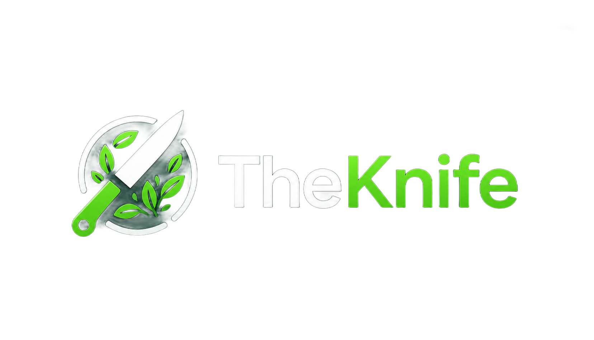

<div align="center">
  
</div>

**Breve descrizione**: Questo è il progetto "theknife.TheKnife", un clone della famosa app TheFork come esercizio universitario

---

## 📌 **Indice**  

1. [Introduzione](#-introduzione)  
2. [Funzionalità](#-funzionalità)  
3. [Installazione](https://github.com/AmStanDem/TheKnife/tree/master?tab=readme-ov-file#%EF%B8%8F-installazione)  
4. [Utilizzo](https://github.com/AmStanDem/TheKnife/tree/master?tab=readme-ov-file#%EF%B8%8F-utilizzo)  

---

## 📜 **Introduzione** 

theknife.TheKnife è una piattaforma multifunzione che ha lo scopo di mettere in contatto clienti e ristoratori in modo intuitivo. Da un lato offre agli utenti la possibilità di scoprire ristoranti in tutto il mondo e selezionarli in base al luogo, alla tipologia culinaria, alla fascia di prezzo, e alla possibilità o meno di prenotare un tavolo o di ordinare da asporto. Dall’altro consente ai ristoratori di promuovere la propria attività o la propria catena di ristoranti inserendo le informazioni essenziali, ricevendo recensioni e dialogando direttamente con la clientela attraverso risposte pubbliche, favorendo così visibilità e miglioramento del servizio.

---

## ✨ **Funzionalità**

1. Modalità guest per permettere all'utente di visualizzare ristoranti vicini senza doversi registrare/login;
2. Una volta registrato, il cliente potrà mettere nella lista dei preferiti i ristoranti che gli sono piaciuti;
3. Il cliente può inserire recensioni e valutare i ristoranti e, in futuro, modificare o rimuovere le sue recensioni;
4. Il ristoratore può comodamente visualizzare tutte le recensioni e le medie di stelle dei suoi ristoranti;
5. Il ristoratore può rispondere alle recensioni lasciate dai clienti dei suoi ristoranti.

---

## ⚙️ **Installazione**  

### Requisiti

- JDK 21 o successivo
- Maven 3.9 o successivo
- PostgreSQL 16 con estensione PostGIS

### Struttura Maven e build

Il repository è un reactor Maven composto da tre moduli:

- `common`: DTO, eccezioni e interfaccia RMI condivisi
- `server`: servizi, DAO, implementazione RMI e migrazioni database
- `client`: interfaccia JavaFX, FXML, CSS e immagini

Le classi sono contenute nel namespace `org.uninsubria.theknife`. Il client e il server dipendono entrambi da `common`, senza dipendenze reciproche.

Dalla directory radice:

```sh
mvn clean package
```

Una singola build genera `bin/theknife-server.jar` e i JAR client per Linux, Windows
e macOS (`bin/theknife-client-linux.jar`, `bin/theknife-client-windows.jar` e
`bin/theknife-client-macos.jar`). Ogni JAR JavaFX include le librerie native della
rispettiva piattaforma: distribuisci a ogni compagno il file corrispondente al suo
sistema operativo.

### Aggiornamento tra client

Le viste di dettaglio ristorante, ricerca, ristoranti del gestore, preferiti e
recensioni personali usano callback RMI per ricevere notifiche di invalidazione
dopo modifiche a recensioni, risposte, ristoranti o preferiti. Ogni vista ricarica
i dati dal server; le sottoscrizioni vengono rimosse quando la vista viene chiusa.
Non viene eseguito polling periodico.

### Database e avvio del serverTK

PostgreSQL nel container ascolta sulla porta interna `5432`, la sua porta predefinita. Compose la pubblica sull'host usando `DB_HOST_PORT`, anch'essa predefinita a `5432`. Se la porta host è già occupata da un PostgreSQL locale, imposta per esempio `DB_HOST_PORT=5433` in `.env`; copia `.env.example` in `.env` e avvia il database con `docker compose up -d db`. Non modificare la porta interna `5432`.

Per avviare i processi da Maven, usa due terminali dalla directory radice. Nel primo:

```sh
mvn -pl server -am -Prun-server integration-test
```

Il server applica le migrazioni, chiede i parametri del database e resta in ascolto.
Rimane attivo finché non interrompi Maven con `Ctrl+C`. Nel secondo avvia il client:

```sh
mvn -pl client -am -Prun-client integration-test
```

In alternativa, dopo la build puoi avviare i JAR con `java -jar`: prima il server e
poi il client Linux o Windows corrispondente. Premi Invio per accettare i valori
predefiniti. Se scegli una porta diversa nel prompt, configura la stessa
`DB_HOST_PORT` in `.env` e riavvia Compose prima di connettere il server.

### Test concorrenti RMI

Il profilo opzionale `concurrency-tests` esegue un harness che crea fixture temporanee e verifica
via due chiamate RMI sincronizzate con barriera: aggiunta duplicata ai preferiti, recensione
duplicata e conflitto tra due aggiornamenti della stessa recensione. Il test elimina le fixture
al termine e deve essere eseguito solo contro un database dedicato già migrato (mai contro il DB
di sviluppo o produzione). Avvia prima il server connesso a quel database, poi esegui:

```sh
export THEKNIFE_TEST_JDBC_URL='jdbc:postgresql://localhost:5432/theknife_test'
export THEKNIFE_TEST_DB_USER='admin'
export THEKNIFE_TEST_DB_PASSWORD='...'
mvn -pl server -am -Pconcurrency-tests integration-test
```

Il registry RMI predefinito è `localhost:1099`; si può configurare con `THEKNIFE_RMI_HOST` e
`THEKNIFE_RMI_PORT`. Le corse verificano invarianti e conflitti per queste operazioni specifiche,
non costituiscono una dimostrazione generale di tutte le proprietà ACID del sistema.

### Stima dei prezzi del dataset

L'importatore usa la colonna `Price` del CSV Michelin: il numero di simboli valuta determina una
delle quattro fasce (€ 12–25, € 25–50, € 50–80, oltre € 80). Applica poi un coefficiente
indicativo per il costo della vita del Paese e una variazione deterministica all'interno della
fascia, così i ristoranti della stessa categoria non ricevono tutti lo stesso importo.
Gli importi sono stime in euro, non prezzi verificati; l'interfaccia li contrassegna con `≈`.
Le righe senza fascia valida restano senza prezzo. All'avvio, il server recupera le stime mancanti
anche per i record del dataset già presenti, senza modificare i prezzi dei ristoranti gestiti.

Flyway usa la stessa porta predefinita `5432`; per una porta host diversa avvia Maven indicando `-Ddb.host.port=<DB_HOST_PORT>`. Quando il server è avviato da un terminale, la password non viene mostrata. In un IDE senza terminale associato può risultare visibile durante la digitazione.

---

## 🖥️ **Utilizzo**

📒 **Manuale utente**
[](https://github.com/AmStanDem/TheKnife/blob/master/doc/ManualeUtente_v3.pdf)

🔧 **Manuale tecnico**
[](https://github.com/AmStanDem/TheKnife/blob/master/doc/ManualeTecnico_v2.pdf)
